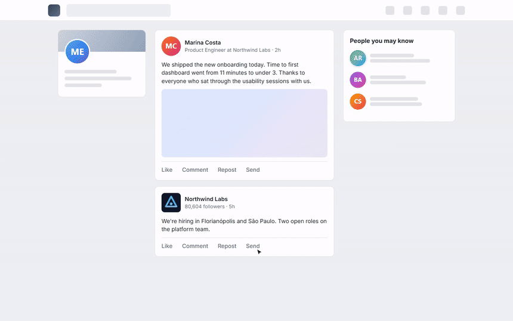

<p align="center">
  
</p>

<h1 align="center">QuickLook - Profile Preview</h1>

<p align="center">
  Hover over a person or company on LinkedIn and get a summary card. No new tab, no lost scroll position.
</p>

<p align="center">
  
  
  
  
</p>

<p align="center">
  
</p>

<p align="center"><sub>Demo on a mock feed with fictional people. The card is the extension's real code. <a href="docs/media/demo.mp4">MP4 version</a>.</sub></p>

## What the card shows

**People.** Name, pronouns, headline, current role and company, connection degree and the About section. Expand it to see work history and mutual connections.

**Companies.** Tagline, industry, size, headquarters, followers, website, open jobs and the people you know who work there.

From the card you can open the profile, open a message window, copy the summary or save it as a Markdown file. It works in light and dark mode, in Portuguese and English, and you can drag it out of the way. `Esc` closes it.

## Privacy

The extension has no server. It reads what LinkedIn already shows you, using your own logged-in session, and only when you hover a name or photo.

- Two permissions: `storage` and `https://www.linkedin.com/*`.
- Profiles you've seen are cached in `chrome.storage.session` for 24 hours and vanish when the browser closes. The popup has a button to clear them.
- No analytics, ads or tracking. The only requests go to linkedin.com. Nothing reaches the developer or any third party.
- It never messages, connects or follows anyone for you.
- A built-in limit allows 20 lookups per minute, summaries and expanded sections combined. Cached profiles don't count.

Full policy in [PRIVACY.md](PRIVACY.md).

## A word on LinkedIn's terms

LinkedIn's User Agreement doesn't allow extensions that read profile data. QuickLook reads the same internal API and profile pages the LinkedIn site loads, up to four requests per person, and doesn't automate anything. I think the practical risk is low. It isn't zero, and the extension says so on first use. The reasoning is in [ADR 0001](docs/adr/0001-voyager-com-risco-aceito.md) (Portuguese).

QuickLook is an independent project with no affiliation to LinkedIn.

## Install from source

The Chrome Web Store listing isn't live yet. To try it now you need Node 22.12 or newer:

```bash
git clone https://github.com/fior-dev/quicklook-profile-preview.git
cd quicklook-profile-preview
npm install
npm run build
```

Then open `chrome://extensions`, turn on Developer mode, click **Load unpacked** and pick the `dist` folder.

## Development

| Command | What it does |
|---|---|
| `npm run dev` | Vite dev server with hot reload for the extension |
| `npm test` | Vitest suite against recorded fixtures |
| `npm run typecheck` | TypeScript, no emit |
| `npm run package` | Production build plus the `.zip` for the Chrome Web Store |

Built with Preact, Tailwind CSS 4, Vite and CRXJS. The tests run against synthetic copies of real LinkedIn responses in [`tests/fixtures`](tests/fixtures). No real person's data is in the repo.

```
src/
  content.ts     hover detection and keyboard
  source.ts      fetches the summary from LinkedIn's API and profile HTML
  details.ts     work history, mutual connections, jobs
  guard.ts       24h cache and rate limit
  Card.tsx       the card, its placement and drag
  popup.tsx      toolbar popup (on/off, language, hover delay, clear cache)
  welcome.tsx    first-use notice
```

Design decisions live in [`docs/adr`](docs/adr), in Portuguese.

## License

[MIT](LICENSE)
